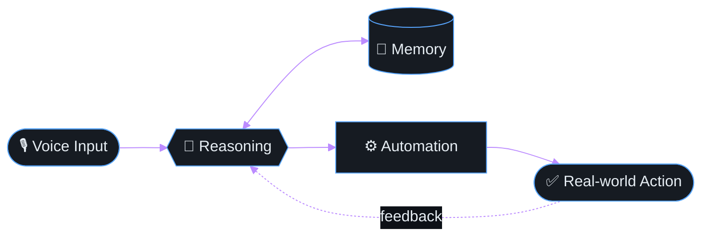

<div align="center">


<a href="https://github.com/RR024">
  
</a>

<br/>


</div>

<br/>

## `$ cat /proc/self/status`

```yaml
Name     : Rohitram J V
Alias    : rr024
Role     : Aspiring AI & Data Science Engineer
Location : Chennai, India
Mission  : Bridge AI innovation with real-world usability
Status   : Always learning. Always shipping.
```

<br/>

## `$ ps aux | grep "nero"`

```text
PID  COMMAND        STATUS    DESCRIPTION
001  project-nero   RUNNING   Personal AI assistant — voice, memory, automation
002  portfolio      LIVE      rr024.github.io/Portfolio
003  express-react  LEARNING  Deep-diving backend + frontend
004  open-collab    OPEN      High-impact, interesting projects — IoT · ML · Web
```

<div align="center">

### 🚀 Featured: **Nero**

*A personal AI assistant built from scratch, designed to be genuinely useful rather than a showcase piece.*



</div>

<br/>

## `$ ls -la skills/`

<div align="center">


<br/><sub><b>Languages</b></sub>
<br/><br/>

<br/><sub><b>Frontend</b></sub>
<br/><br/>

<br/><sub><b>Backend &amp; Databases</b></sub>
<br/><br/>

<br/><sub><b>AI / ML</b> — not just running notebooks, building custom models for real systems</sub>
<br/><br/>

<br/><sub><b>Tools &amp; Platforms</b></sub>

</div>

<br/>

## `$ git log --graph --format="%s %d"`

```text
* 🚀 Nero v0.1 alpha                   [building]
|
* 🌐 Portfolio deployed                 [live → rr024.github.io/Portfolio]
|
* 📡 IoT hackathon project              [shipped]
|
* 🎓 Express.js + React deep-dives      [in-progress]
|
* 🤝 Open for collabs                   [always]
```

<br/>

## `$ github-stats --verbose`

<div align="center">

<a href="https://github.com/RR024">
  
</a>
<a href="https://github.com/RR024">
  
</a>

<a href="https://github.com/RR024">
  
</a>

<br/>


</div>

<br/>

## `$ ./snake --eat contributions`

<div align="center">

<picture>
  <source media="(prefers-color-scheme: dark)" srcset="https://raw.githubusercontent.com/RR024/RR024/output/github-snake-dark.svg" />
  <source media="(prefers-color-scheme: light)" srcset="https://raw.githubusercontent.com/RR024/RR024/output/github-snake.svg" />
  
</picture>

</div>

<br/>

## `$ cat manifesto.txt`

```text
An engineer who builds systems that actually do things — not just demos.

Thriving at the intersection of ML, IoT, and web tech.
Hands-on from hackathons to hobby projects to production.

Currently training Nero: an AI assistant that remembers,
reasons, and acts — designed around real usability.

The goal isn't to impress. It's to be useful.
```

<br/>

<div align="center">

<a href="https://rr024.github.io/Portfolio/"></a>
<a href="https://www.linkedin.com/in/rohitram-jv"></a>
<a href="mailto:rohitramjv05@gmail.com"></a>
<a href="https://github.com/RR024"></a>
<a href="https://discord.com/users/Shoyo"></a>

<br/><br/>

`// let's build something remarkable`


</div>
